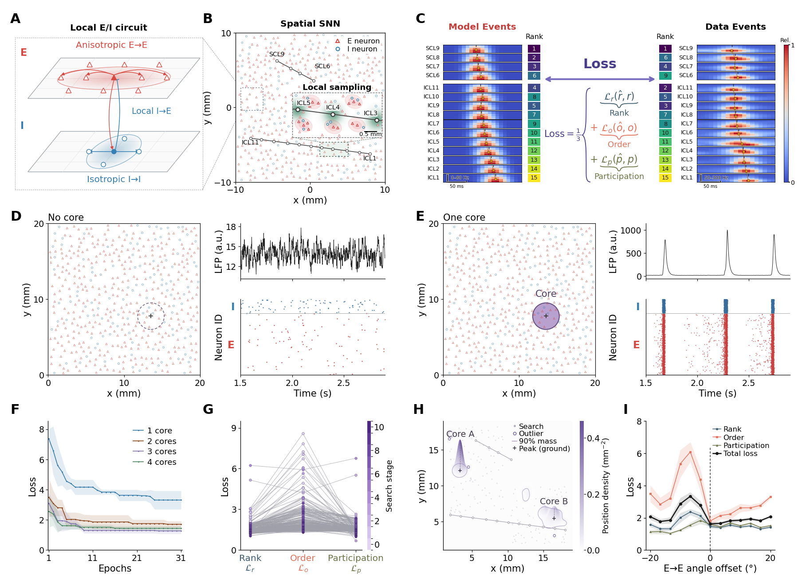

# 当前 Figure 4：空间网络构建与优化

作者于 2026-11-02 确认 `snn_layout_ei_labels_20261031` 图面并授权提交、推送。正式版本为 `snn_network_optimization_final_20261102`，状态 `AUTHOR_ACCEPTED_FINAL`。



[完整 PNG](../results/paper-ready-figure/fig4/figures/fig4-complete-layout.png) · [PDF](../results/paper-ready-figure/fig4/figures/fig4-complete-layout.pdf) · [图注](../results/paper-ready-figure/fig4/captions_fig4_fig5_zh.tex)

## 图件分工与面板

原 Figure 4 拆成 Figure 4（网络、观察与优化）和 [Figure 5](current_figure5.md)（双向传播与单／双 core 比较）；原 Figure 5 的状态动力学内容现为 [Figure 6](current_figure6.md)。图号调整不改变各自数据与统计口径。

| 面板 | 当前内容 | 解释范围 |
|---|---|---|
| A | 局部 E/I 回路，E→E 各向异性连接 | 示意图，不是网络的两层解剖结构 |
| B | 患者电极几何、空间网络及高斯局部采样 | 说明神经元活动如何映射至虚拟触点 |
| C | 模型／患者代表事件、Rank／Order／Participation 与三分量损失 | 实际优化比较固定 60 s 仿真中的合格事件分布；单个事件仅作示意，谱图圆点与训练时刻短线含义不同 |
| D | 无 core 的稀疏背景活动、局部 raster 和电流 LFP 代理 | 圆圈为与 E 对应的读出 ROI；白底、虚线无填色 |
| E | 单 core 的局部同步簇发 | 只在 core 内填紫色，外部白底；D/E 的原生 LFP 独立纵轴尺度，不能当作同幅度绘图 |
| F | 1–4 core、每组 4 次重复、共同前 31 个 epoch | 最佳训练 J 的均值 ± 样本标准差；没有新增 core 数量显著性检验 |
| G | 参数搜索中的三个实际训练损失 | J=(L_r+L_o+L_p)/3；搜索阶段不是单条连续收敛轨迹 |
| H | 413 个可评分配置中训练 J 最低 20%（83 个）的 core 位置密度 | 搜索池中的低损失集中区，不是后验分布或所有初始化收敛证明 |
| I | 13 个 E→E 方向的训练损失及 J | 时间块 bootstrap 标准差；参考轴偏移 0°处总损失最低 |

B/D/E 共享原神经元坐标的间距筛选子集，空间示意避免符号重叠，仿真的细胞、连接与 spike 数据不变。D/E raster 保留 ROI 内全部 847 个 E 和 191 个 I 神经元及原顺序，移除人数刻度，纵轴为 Neuron ID；E 红、I 蓝，与 A 一致。LFP 与 Neuron ID 标签对齐，D 的 LFP 刻度为 12、15、18。

## 校验与重绘

```bash
python scripts/paper_figures/build_fig4_current.py
python scripts/paper_figures/build_fig4_current.py --output-dir /tmp/fig4-restored
python scripts/paper_figures/render_fig4_current.py --output-dir /tmp/fig4-redrawn
```

第一条核对正式包，第二条向独立空目录恢复逐字节一致的导出，第三条只读取包内冻结输入重绘，不重跑仿真。精确恢复只需 Python 标准库；原生重绘需要 NumPy、SciPy、Matplotlib。全部正式图及 A–I、D/E 联图位于 `results/paper-ready-figure/fig4/figures/`。当前入口依次为 `current_version.json`、`figure4_panel_registry.json`、`release_manifest.json`，配置为 `config/figure4_current.json`。

上一正式版完整保存在 `results/paper-ready-figure/archive/2026-11-02_fig4_reorganization/fig4/`；更早历史见 `historical_versions.json`。历史 D 方向响应已成为当前 I，历史 E 位置密度已成为当前 H，不能按旧面板字母恢复旧图。后续修订先输出独立候选，保留其他面板的当前数据。
