# 癫痫文章：Supplementary 逐项检查

**2026 年 10 月 30 日整理；2026 年 11 月 3 日更新**

按“图 → 中文 caption → 原图链接 → 正文／主图对应”逐项排列，随后列出补充视频、临床表和检查汇总。当前保留 S1–S8，空间聚类候选暂列于 S3 下；尚未编号的图以内容标题标识。

[查看逐图主旨、结论依据与正文引用建议](Supplementary_正文与主图对应审阅.md)。

## Supplementary Figure 1｜人工标注事件的形态与频谱

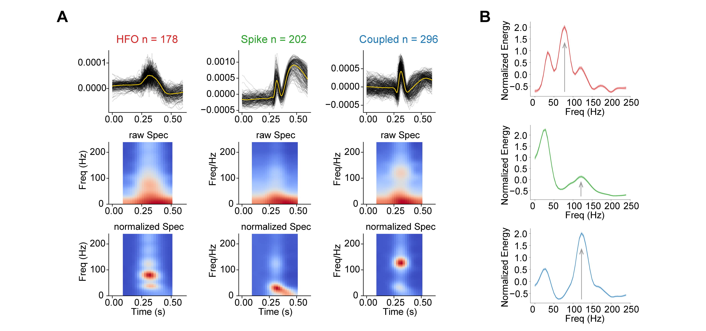

**人工标注的 HFO、棘波与耦合事件具有不同的形态和频谱特征。**

**A，** HFO（$n=178$）、棘波（$n=202$）和耦合事件（$n=296$）的对齐波形及平均波形（黄色），下方为平均原始与基线归一化时频谱。

**B，** 三类事件的平均归一化频谱，阴影为均值标准误。HFO 与耦合事件的高频峰分别约为 80 Hz 和 120 Hz，棘波以低频成分为主。

[PNG](figures/current/S1.png) · [PDF](figures/current/S1.pdf)

**支持正文／主图：** 为正文的 HFO 事件定义及主图 1A/B 提供人工标注波形与频谱依据。

## Supplementary Figure 2｜HFO 负荷与临床 SOZ 的对应

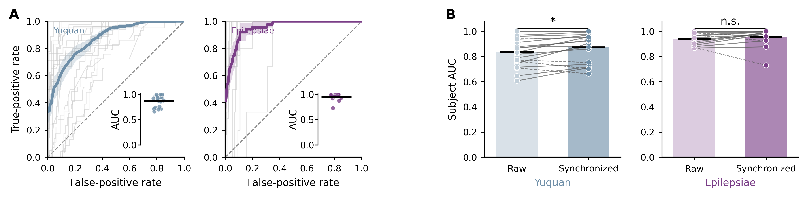

**群体事件筛选前后的 HFO 负荷与临床 SOZ 的对应。**

**A，** Yuquan（20 名患者）和 Epilepsiae（15 名患者）的群体事件窗内触点 HFO 负荷区分 SOZ 与非 SOZ 的 ROC 曲线。灰线为患者，彩线与阴影为队列均值及标准误；插图为患者 AUC，均值分别为 0.873 和 0.955。

**B，** 全部HFO（Raw）与群体事件窗内 HFO（Synchronized）的患者 AUC 配对比较，均值分别为 0.837→0.873 和 0.939→0.955。连线连接同一患者，柱与黑线为均值。双侧配对 Wilcoxon 检验；\*，$P<0.05$；n.s.，$P\geq0.05$。

[PNG](figures/current/S2.png) · [PDF](figures/current/S2.pdf)

**支持正文／主图：** 支持群体事件窗内 HFO 负荷与临床 SOZ 的对应，为主图 1 的患者内时序分析提供临床背景。

## Supplementary Figure 3｜模板数量扫描与高阶模板

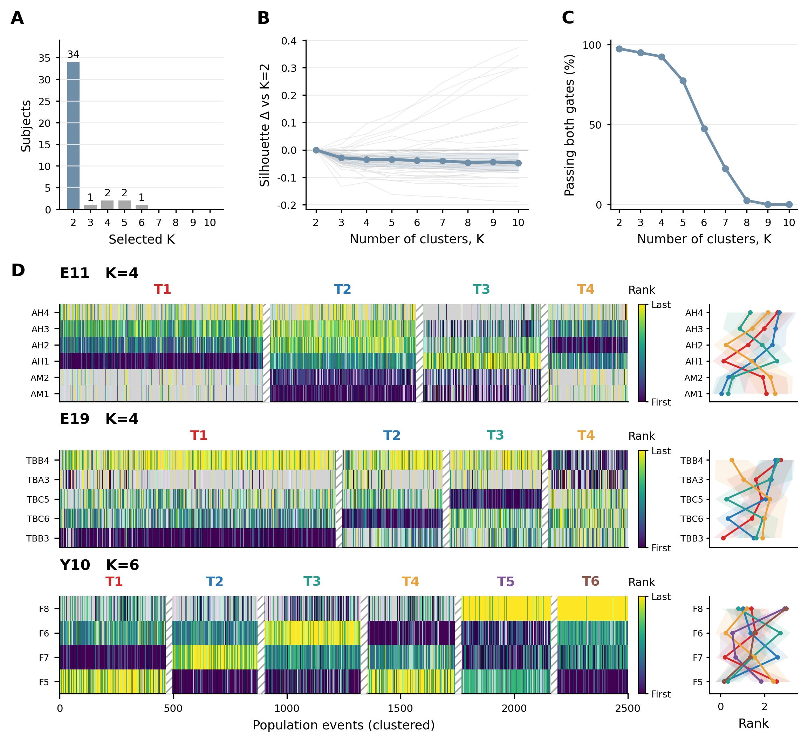

**多数患者呈双模板结构，部分患者保留更高阶模板。**

**A，** 40 名患者在 $K=2$–$10$ 扫描中选出的模板数分布，34/40 名患者选择 $K=2$。

**B，** 各患者相对于 $K=2$ 的轮廓系数变化。灰线为患者，蓝线及阴影为队列中位数及四分位距。

**C，** 各 K 下同时满足聚类稳定性和最小簇占比要求的患者比例：种子间中位调整互信息（AMI）≥0.70，最小簇事件占比≥0.10。在满足上述要求的解中，按中位轮廓系数选择 K。

**D，** 自上而下为 E11（$K=4$）、E19（$K=4$）和 Y10（$K=6$）的间期 HFO 传播模板，每位患者展示 2,500 次群体事件。热图右侧色条表示由早至晚的传播顺序，灰色表示未参与触点，斜线间隔区分模板；右侧 Rank 图按相同触点顺序展示各模板的平均秩次及 ±1 个标准差。

[PNG](figures/current/S3.png) · [PDF](figures/current/S3.pdf)

**支持正文／主图：** 支持主图 1E/F 的模板数量选择；多数患者选择两个模板，部分患者保留高阶结构。

### Spatial TRAJ. 的 S3 候选

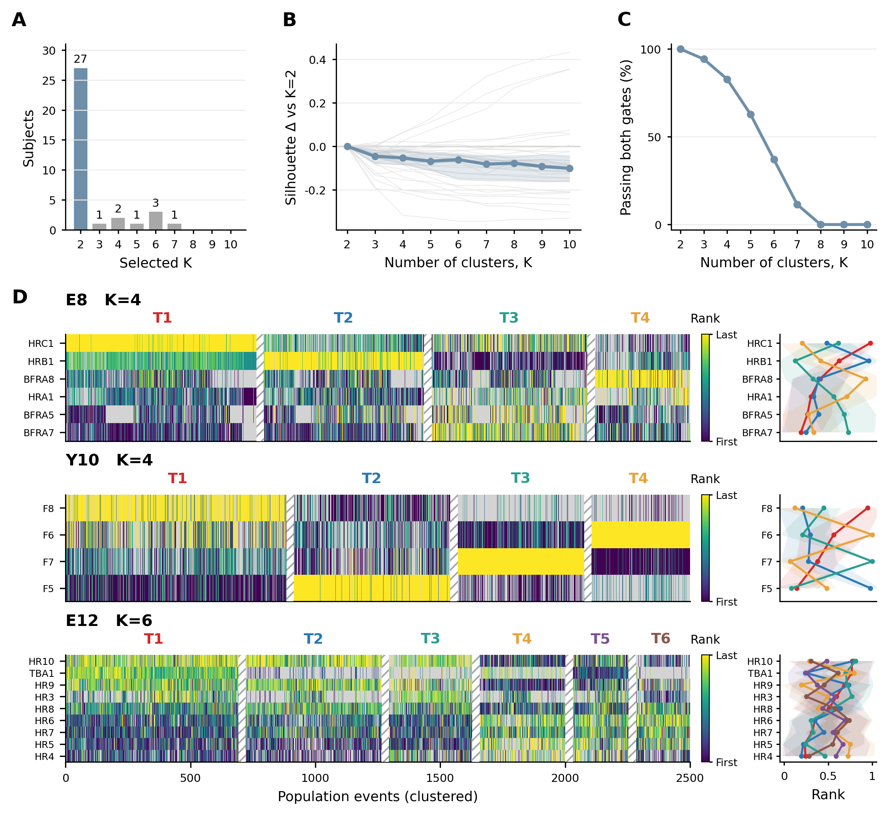

**Spatial TRAJ. 的模板数量与间期 HFO 招募顺序。**

**A，** 35 名患者采用招募 rank 与三维传播方向联合聚类，在 $K=2$–$10$ 中选出的模板数分布；27/35 名患者选择 $K=2$。

**B，** 各患者相对于 $K=2$ 的轮廓系数变化。灰线为患者，蓝线及阴影为队列中位数及四分位距。

**C，** 各 K 下满足种子间中位调整互信息（AMI）≥0.70、最小簇事件占比≥0.10 的患者比例；在满足条件的解中按中位轮廓系数选择 K。

**D，** 自上而下为 E8（$K=4$）、Y10（$K=4$）、E12（$K=6$）。每位患者展示 2,500 次按时空聚类标签排列的间期 HFO 群体事件。颜色表示事件内归一化招募秩次，灰色为未参与触点；右侧为各模板的触点平均归一化秩次及 ±1 个标准差。

[PNG](figures/current/S3_spatial.png) · [PDF](figures/current/S3_spatial.pdf)

**支持正文／主图：** 补充主图 2 的 Spatial TRAJ. 模板数量选择；与原 Rank SEQ 版分别对应空间与时序分析。

### 同一患者与事件的两种聚类对照

**Rank SEQ 与 Spatial TRAJ. 的模板数量及招募顺序。**

**A，** 同 35 名患者、同一批间期 HFO 群体事件在 Rank SEQ（灰）与 Spatial TRAJ.（蓝）中选出的模板数分布。

**B，** 两种方法相对于各自 $K=2$ 的轮廓系数变化，中位数及四分位距。

**C，** 满足种子间中位 AMI≥0.70、最小簇事件占比≥0.10 的患者比例。在满足条件的解中，按中位轮廓系数选择 K。

**D，** 自上而下为 E8（$K=4$）、Y10（$K=4$）、E12（$K=6$）。每位患者展示 2,500 次按时空聚类标签排列的间期 HFO 群体事件。颜色表示事件内归一化招募秩次，灰色为未参与触点；右侧为各模板的触点平均归一化秩次及 ±1 个标准差。

[PNG](figures/current/S3_spatial_comparison.png) · [PDF](figures/current/S3_spatial_comparison.pdf) · [同事件时序版](figures/current/S3_matched_timing.png) · [时序版 PDF](figures/current/S3_matched_timing.pdf) · [结果与选图建议](statistics/S3_spatial_clustering.md)

**选图建议：** 保留原时序 S3 对应主图 1；新增空间聚类补图对应主图 2，优先采用上排含同事件对照的版本。当前将两版放在 S3 下供比较，暂不调整后续图号。

## Supplementary Figure 4｜传播模板的方向分离与跨记录块复现性

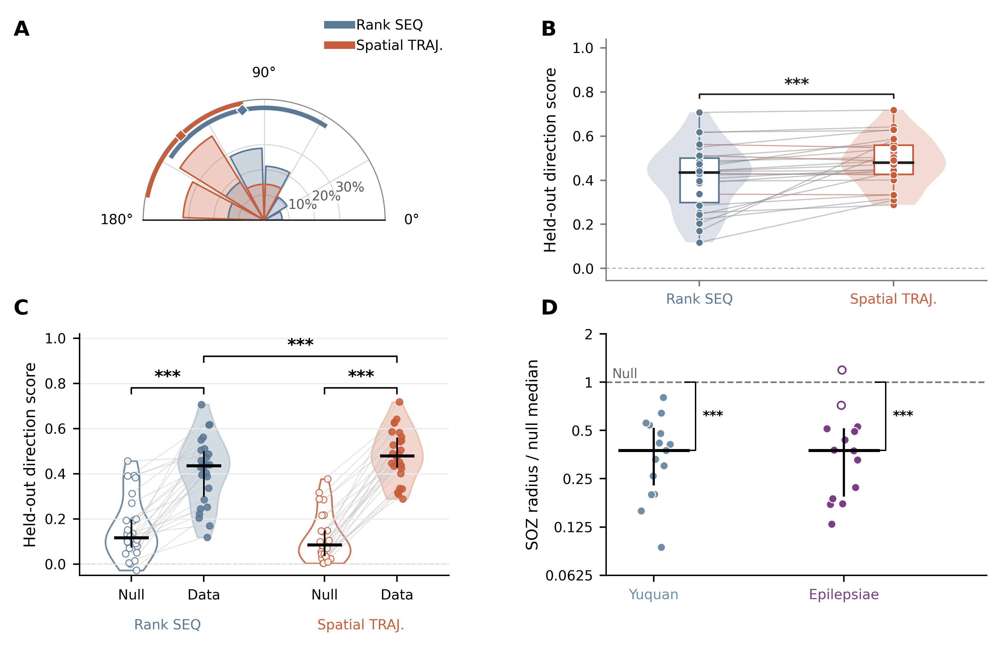

**HFO 传播模板的方向分离与跨记录块复现性。**

**A，** 28 名患者的 TA–TB 三维轴夹角分布，蓝、橙分别表示 Rank SEQ 和 Spatial TRAJ.。菱形与弧线为均值±标准差，分别为 101.3°±45.0° 和 134.6°±34.4°；180° 表示反向。

**B，** 交替记录块交叉验证中，仅依据招募 rank 将留出 HFO 事件分配至训练模板，再计算事件方向与模板轴的平均有符号余弦，两折、两模板等权。26 名患者中，Spatial TRAJ. 的方向得分中位数由 0.435 增至 0.479，22 名患者提高。点和连线表示患者及配对关系，箱体与黑线为四分位距和中位数。

**C，** 保持训练模板和事件分配不变，在留出记录块内置换事件方向。空心、实心分别表示各患者的置换得分中位数与观测得分，连线连接同一患者。

**D，** 临床 SOZ 触点的空间紧凑性：SOZ 触点的均方根（RMS）半径除以同患者等数量随机触点半径的中位数（20,000 次抽样）。Yuquan、Epilepsiae 分别为 15、14 名患者；虚线为 1，实心点表示患者内置换检验 $P<0.05$，横线与竖线为中位数和四分位距。B/C 采用单侧配对 Wilcoxon 检验，D 对 $\log_2$ 比值相对零采用单侧 Wilcoxon 检验；\*\*\*，$P<0.001$。

[PNG](figures/current/S4.png) · [PDF](figures/current/S4.pdf)

**支持正文／主图：** A 补充主图 2C–E 的方向关系；B/C 检验按 rank 分配的事件在留出记录块中能否复现模板方向，与主图 2B 的最近方向角误差互补。D 单独提供临床 SOZ 的局部几何背景。

## Supplementary Figure 5｜患者间期 HFO 的空间传播

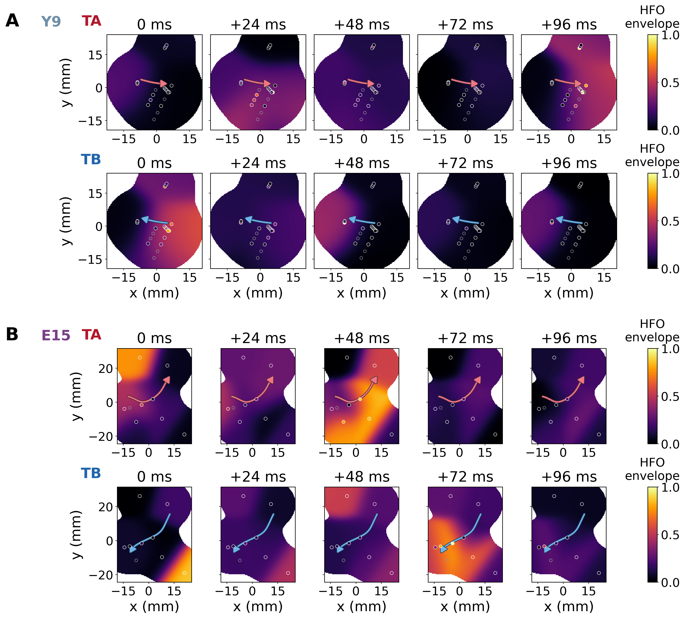

**两队列患者的间期 HFO 空间传播。**

**A，** 玉泉患者 Y9。**B，** Epilepsiae 患者 E15。各面板上、下行分别为 TA、TB 事件，显示 0–96 ms，间隔 24 ms。颜色表示经空间平滑、逐事件归一化的 HFO 包络；实心和空心圆分别表示参与及未参与触点。红、蓝箭头分别表示 TA、TB 模板由早至晚的空间轨迹。时间以各事件最早时频质心为零，x 沿患者的 TA 传播轴。

[PNG](figures/current/S5.png) · [PDF](figures/current/S5.pdf) · [事件与显示方法](statistics/S5_propagation_examples.md)

**支持正文／主图：** 将主图 1 的事件内招募顺序与主图 2 的空间模板联系起来，展示玉泉与 Epilepsiae 各一名患者的 TA/TB 代表事件。

## Supplementary Figure 6｜发作早期频谱特征与能量频带的选择

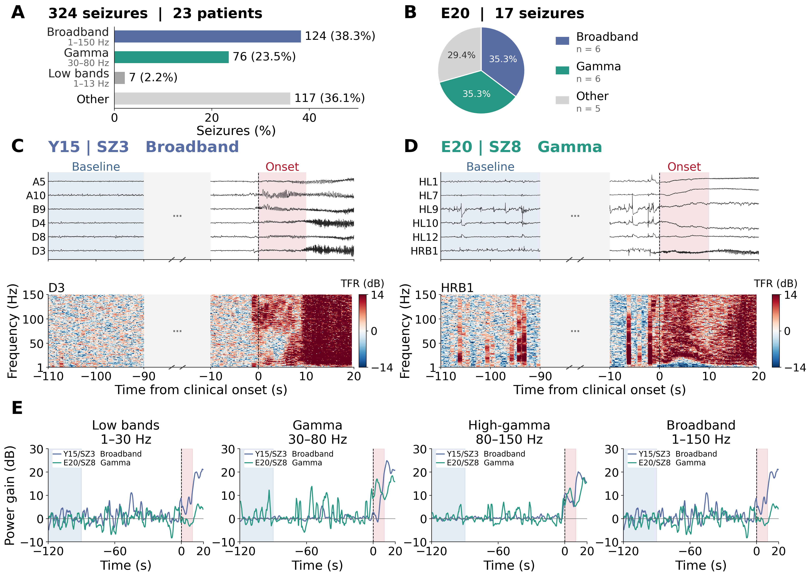

**2026-11-03 排版更新：** A 的标题与内容左移收紧，Low bands 与 1–13 Hz 分为两行；A/B 的标题字号、面板字母与下方 C/D 对齐，B 饼图及图例间距收紧。C、D 保留各自 −14 至 14 dB 的 TFR 色条。分类、计数及频谱数据保持不变。

**2026-11-03 修改：** A 将类型与频段分行；B 改为 E20 的患者内饼图并将百分比收进扇区；E 的四个子图各在左上角竖排 12 号字图例，避开曲线及起始窗口。图内与图注统一使用 Gamma。

**发作早期频谱特征与能量频带的选择。**

**A，** 23 名患者、324 次发作的频谱分类：宽带型（Broadband）124 次（38.3%）、Gamma 型 76 次（23.5%）、仅低频型 7 次（2.2%）和其他类型 117 次（36.1%）。宽带型与 Gamma 型标签中的 1–150 Hz 和 30–80 Hz 表示相应的早期能量读出频带。

**B，** 同一患者 E20 的全部 17 次已分类发作中，宽带型和 Gamma 型各 6 次（各 35.3%），其他类型 5 次（29.4%）。宽带型和 Gamma 型是该患者占比最高的两类，合计占 70.6%，显示两种主要频谱类型可在同一患者内并存。

**C、D，** 玉泉 Y15/SZ3（宽带型）和 Epilepsiae E20/SZ8（Gamma 型）的脑电及代表触点 D3、HRB1 的时频谱。

**E，** 同一代表触点在 1–30、30–80、80–150 和 1–150 Hz 的功率增幅，按 2 s 平滑。蓝、绿曲线分别对应 Y15/SZ3（Broadband）和 E20/SZ8（Gamma），各子图左上角分别给出图例。时间以临床起始为零；淡蓝、淡红区域分别为 −120 至 −90 s 基线和 0–10 s 早期窗口，功率增幅以相对基线的 dB 表示。

[PNG](figures/current/S6.png) · [PDF](figures/current/S6.pdf) · [A/B 局部图](figures/current/S6_AB.png) · [E 图](figures/current/S6_E.png) · [TFR 局部图](figures/current/S6_TFR.png) · [中文图注](captions/S6_zh.md) · [English caption](captions/S6_en.md) · [分类、特征定义与病例核对](statistics/S6_spectral_features.md)

**支持正文／主图：** 补充主图 3A–C 的频谱背景与能量场构建，展示 E20 内宽带型和 Gamma 型共存且占主要部分，并说明两类发作所采用频带的依据。

## Supplementary Figure 7｜发作早期能量场与间期传播场的多频带空间相关

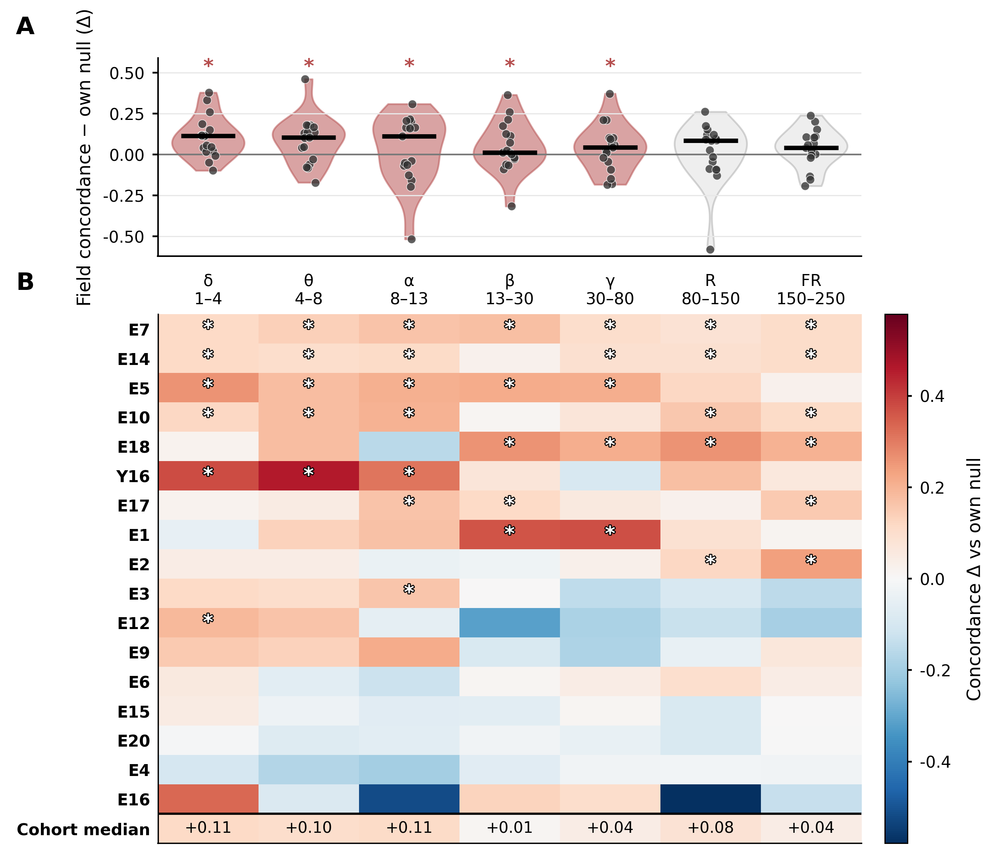

**发作早期能量场与间期传播场在不同频带中的空间相关。**

**A，** 17 名患者中，发作早期能量场与间期 HFO 传播场（TA/TB）的空间相关。每次发作取与 TA/TB 中较匹配模板的 Pearson 相关系数绝对值 $|r|$，并在患者内对各次发作取中位数；纵轴 $\Delta$ 为该值减去 1,000 次触点置换零模型的中位数。点为患者，黑线为队列中位数；红色及星号表示逐频带队列置换检验 $P<0.05$。

**B，** 各患者、各频带的 $\Delta$，底行为队列中位数；空心星号表示患者自身触点置换检验 $P<0.05$。A/B 星号均基于未校正的 $P$ 值。

[PNG](figures/current/S7.png) · [PDF](figures/current/S7.pdf) · [统计明细](statistics/S7_multiband_statistics.md)

**支持正文／主图：** 补充主图 3A–C 的发作早期能量场与间期 HFO 传播场空间相关，展示其在七个频带和不同患者中的分布。

## Supplementary Figure 8｜模型间期活动的传播

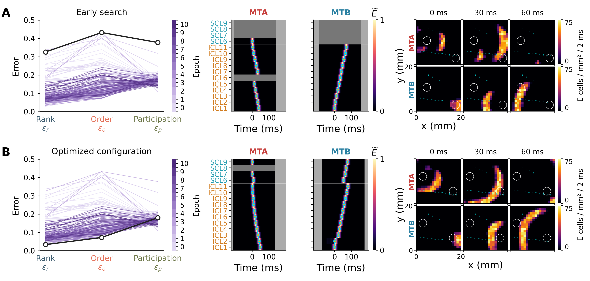

**不同拟合配置中的模型间期传播。**

**A、B，** 分别为搜索早期与优化配置。左侧为 194 个参数配置的 Rank、Order、Participation 评估误差；每条细线代表一个配置，颜色表示 Epoch（搜索轮次 0–10，与主图 4 编号一致），黑色粗线及空心圆对应本行传播示例。中间为该配置下 MTA/MTB 代表事件的归一化触点包络及质心轨迹；右侧为 0、30、60 ms 的空间活动。白圈为 core，浅蓝符号为虚拟触点；空间场共用 0–75 个 E 细胞/mm²/2 ms 色标。时间相对各事件最早有效质心。对应 Supplementary Video 2。

[PNG](figures/current/S8.png) · [PDF](figures/current/S8.pdf) · [评估误差与搜索轮次](statistics/S8_evaluation_error.md)

**支持正文／主图：** 补充主图 4 的参数拟合与主图 5 的模型传播读出，展示各搜索轮次的三项评估误差，并将本行配置与其招募顺序及空间传播对应。

## 待编号补图｜Z 状态干预、M 反馈与高活动进入时间

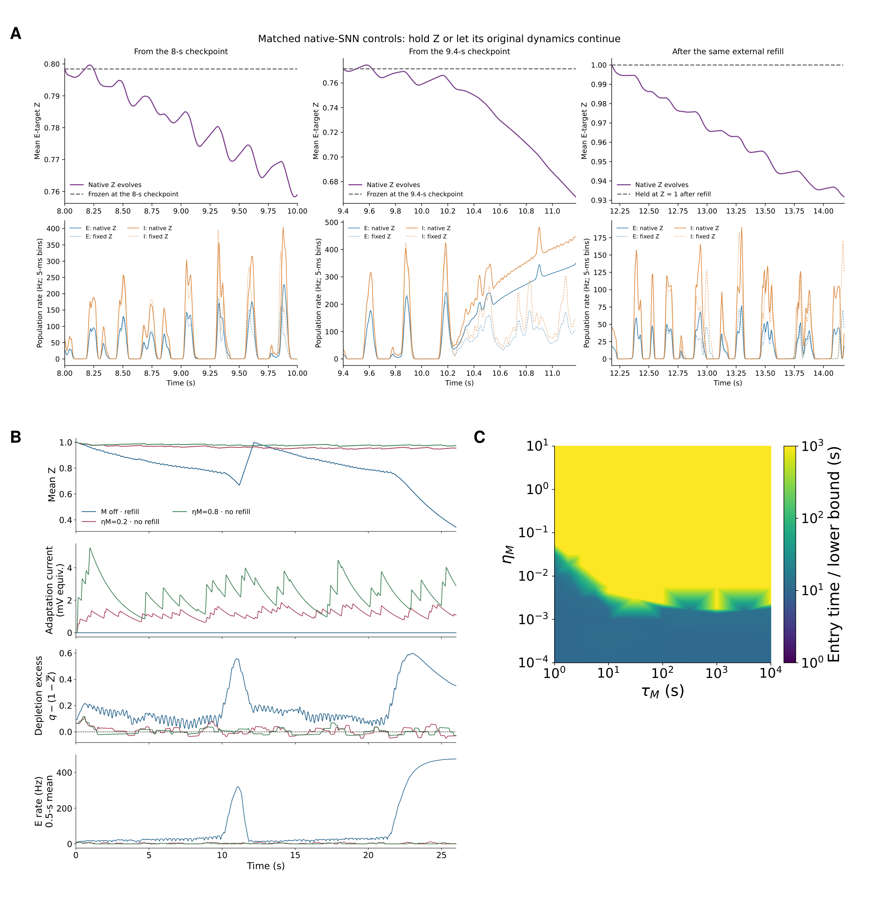

**历史双核模型中，Z 状态与 M 反馈对高活动进入的影响。**

**A，** 从 8 s、9.4 s 检查点及同一次外部补回后，比较 Z 自然演化与冻结状态。上排为平均 Z，下排为 E/I 群体发放率。

**B，** M-off 与 $\eta_M=0.2/0.8$ 条件下的 Z、适应电流、耗竭超额及 E 发放率。M-off 接受阈值触发的外部 Z 补回，另外两组未补回，$\tau_M=2$ s。

**C，** 70 个 $\eta_M\times\tau_M$ 组合的首次高活动进入时间；进入判据为 E 群体 10 ms 分箱发放率连续 200 ms 不低于 200 Hz。色条为 1–1000 s 对数刻度，顶端颜色合并晚进入及观察至 1000 或 3000 s 未进入的条件。

[PNG](figures/current/ZM.png) · [PDF](figures/current/ZM.pdf)

**支持正文／主图：** 本图对应旧 Z/M 模型的状态干预与首次高活动进入。当前 Figure 6 已更新模型，本图需随新模型重做后，才能用于支撑其反馈、终止和恢复机制。

## Supplementary Video 1｜患者单次群体事件的空间演化

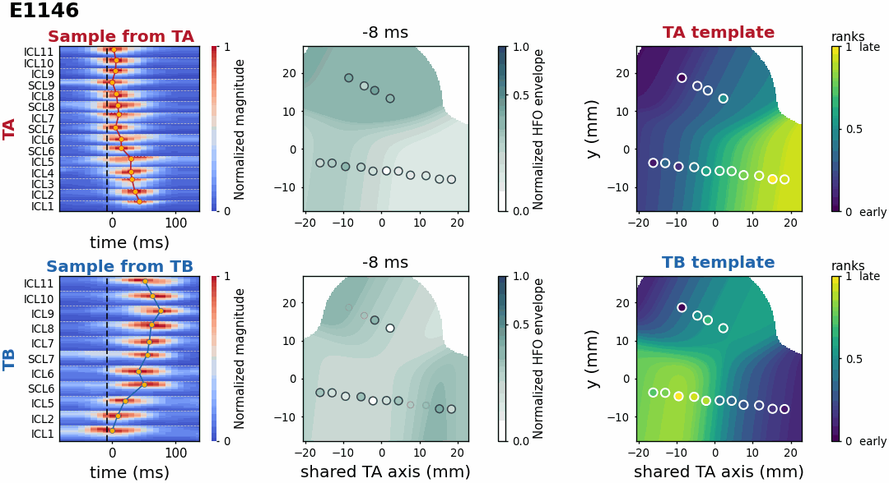

**患者间期 HFO 的空间传播。** E10（视频中标为 E1146）的 TA、TB 代表事件，自左至右为触点时频谱、动态 HFO 包络场及固定模板 rank 场。动态场按各事件完整显示窗内参与触点包络的第 99 百分位归一化；时间相对各事件最早有效时频质心。显示 −8 至 50 ms，步长 2 ms，以 12.5 帧/s 播放。补充图 S5 展示另外两位患者的传播示例。

[打开 GIF](videos/SupplementaryVideo1.gif)

**支持正文／主图：** 展示主图 1B 的单次事件招募过程及主图 2 的空间模板在真实包络中的时间演化。

## Supplementary Video 2｜两个模型拟合条件的传播对比

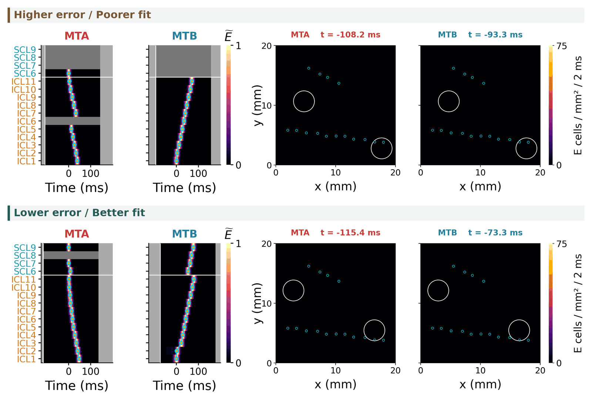

**不同拟合配置中的模型间期传播。** 上、下排分别为较高与较低训练误差配置，各展示 MTA/MTB 触点包络及空间活动。白圈为 core，浅蓝符号为虚拟触点；包络与空间场色标分别为 0–1 和 0–75 个 E 细胞/mm²/2 ms。各事件显示完整 250 ms 窗，时间相对最早有效质心，步长 2 ms，以 20 帧/s 播放。静态时刻见补充图 S8。

[打开 GIF](videos/SupplementaryVideo2.gif)

**支持正文／主图：** 展示两个拟合配置的模型传播差异，对应主图 4 的数据约束与主图 5 的传播读出。

## Supplementary Video 4｜E10/SZ3 围发作能量场演化

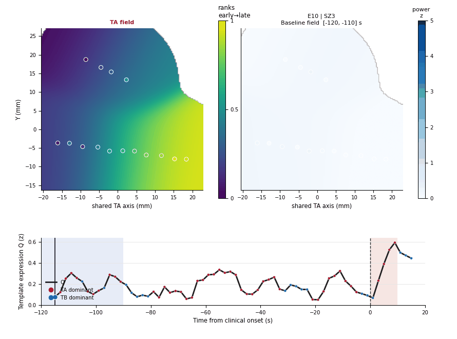

**E10/SZ3 围发作期能量场与间期传播模板。** 左侧为固定 TA 传播场，右侧为 1–150 Hz 滑窗能量场，下方为 $Q=\max(|q_{TA}|,|q_{TB}|)$，红、蓝点分别表示 TA、TB 占优。覆盖临床起始前 120 s 至后 20 s，每窗 10 s、步长 2 s。功率以 EEG 起始前 −120 至 −90 s 为基线进行稳健标准化，色标固定为 0–5；以 6.25 帧/s 播放。

[打开 GIF](videos/SupplementaryVideo4.gif)

**支持正文／主图：** 展示主图 3A 的同一病例能量场及 3D 的围发作时间过程。

## Supplementary Table 1｜Yuquan 患者临床与记录信息

**Yuquan 队列 20 名患者的基本情况、记录和随访。** 每行对应一名患者；年龄以分档表示，记录时长为分析所选记录的时长。当前表沿用现有临床信息，缺失项目保留原有说明。

| Patient | Sex | Age at SEEG (y) | Analyzed duration (h) | Fs (Hz) | Implanted SEEG contacts | Seizures captured | Etiology | Intervention | Outcome / follow-up |
|---|---|---:|---:|---:|---:|---:|---|---|---|
| Y1 | F | 0–5 | 24 | 2000 | 102 | 3 | TSC | Laser ablation | No seizures for 3 years |
| Y2 | M | 0–5 | 24 | 2000 | 148 | 6 | TSC | RF thermocoagulation | No seizures for 1 year |
| Y3 | M | 16–20 | 24 | 2000 | 140 | 3 | FCD | Surgery | No seizures for 4 years |
| Y4 | F | 6–10 | 24 | 2000 | 158 | 2 | TSC | Laser ablation | No seizures for 3 years |
| Y5 | F | 0–5 | 24 | 2000 | 102 | 2 | TSC | Laser ablation | No seizures for 2.5 years |
| Y6 | M | 0–5 | 24 | 2000 | 206 | 17 | TSC | Laser surgery | No seizures for 1 year and 9 months |
| Y7 | F | 0–5 | 22 | 2000 | 172 | 1 | FCD | Surgery | No seizures for 4 years |
| Y8 | F | 6–10 | 26 | 2000 | 142 | 3 | TSC | Surgery | No seizures for 3 years and 5 months |
| Y9 | F | 6–10 | 24 | 2000 | 114 | 3 | FCD | RF thermocoagulation | No seizures for 4 years |
| Y10 | F | 16–20 | 26 | 2000 | 144 | 4 | ganglioglioma | Surgery | No seizures for 3.5 years |
| Y11 | M | 0–5 | 24 | 2000 | 118 | 2 | TSC | Laser ablation | Occasional minor seizures (gelastic) at 3 years |
| Y12 | M | 11–15 | 24 | 2000 | 112 | 1 | TSC | RF thermocoagulation | Occasional minor seizures at 4 years |
| Y13 | M | 21–25 | 26 | 2000 | 148 | 1 | FCD | Laser ablation | Seizures reduced but still present at 3 years |
| Y14 | M | 6–10 | 24 | 2000 | 94 | 1 | FCD | Surgery | No seizures for 4 years and 9 months |
| Y15 | M | 11–15 | **31** | 2000 | 142 | 8 | FCD | Surgery | No seizures for 2 years |
| Y16 | F | 6–10 | 26 | 2000 | 130 | 3 | TSC | Laser ablation | No seizures for 1 year |
| Y17 | F | 0–5 | 26 | 2000 | 104 | 8 | FCD | Laser ablation | No seizures for 1 year and 1 month |
| Y18 | M | 0–5 | 24 | 2000 | 128 | 8 | TSC | Laser ablation | No seizures for 2.5 years |
| Y19 | F | 0–5 | 24 | 2000 | 142§ | 4 | TSC | Not available in mounted source | Not available in mounted source |
| Y20 | M | 11–15 | 24 | 2000 | 134§ | 0‡ | FCD | RF thermocoagulation | Long-term outcome/follow-up not available in case document |

**表注：** F，女性；M，男性；TSC，结节性硬化症；FCD，局灶性皮质发育不良；RF，射频。Y1–Y18 的植入触点数与随访沿用作者临床表。§ Y19/Y20 的 142/134 为暂用的记录触点数，尚未由植入清单核实。‡ Y20 的 0 次发作指所分析记录内未捕获发作。Y15 的记录时长按 30.88 h 四舍五入为 31 h。Y19 的介入与长期随访、Y20 的长期结局仍缺可核验来源。

## Supplementary Table 2｜Epilepsiae 患者临床与记录信息

**Epilepsiae 队列 20 名患者的基本情况、记录及 Engel 结局。** 每行对应一名患者，记录时长为分析所选记录的时长；保留现有表中全部随访时间点。

| Patient | Sex | Age at SEEG (y) | Analyzed duration (h) | Fs (Hz) | Contacts | Seizures captured | Etiology | Engel outcome (follow-up) |
|---|---|---:|---:|---:|---:|---:|---|---|
| E1 | F | 31–35 | 162.6 | 1024 | 100 | 9 | malformation; hippocampal sclerosis | Ia (3 m) |
| E2 | F | 46–50 | 244.7 | 1024 | 117 | 94 | malformation | Ia (3 m); IIb (11 m) |
| E3 | F | 11–15 | 219.1 | 1024 | 121 | 16 | cryptogenic | Ia (3 m) |
| E4 | M | 36–40 | 110.6 | 1024 | 107 | 30 | cryptogenic | Ia (3–24 m) |
| E5 | M | 16–20 | 245.2 | 1024 | 122 | 13 | malformation | Ia (3–24 m) |
| E6 | F | 31–35 | 151.6 | 1024 | 125 | 9 | cryptogenic | IVb (3–6 m) |
| E7 | M | 21–25 | 170.6 | 1024 | 95 | 22 | genetic risk | Ia (3–12 m) |
| E8 | F | 46–50 | 224.0 | 1024 | 96 | 20 | hippocampal sclerosis | IIIa (3–12 m) |
| E9 | F | 36–40 | 260.1 | 512 | 58 | 7 | hippocampal sclerosis | IIb (3 m); Ia (48 m) |
| E10 | M | 21–25 | 113.2 | 1024 | 116 | 26 | vascular hypoxia | Not offered |
| E11 | M | 21–25 | 424.1 | 1024 | 109 | 52 | malformation | Ib (3–24 m) |
| E12 | M | 41–45 | 252.4 | 1024 | 63 | 7 | malformation | Ia (3 m) |
| E13 | F | 21–25 | 63.0 | 1024 | 65 | 23 | malformation; tumor | Ia (3 m); IIa (36 m) |
| E14 | M | 16–20 | 142.0 | 1024 | 109 | 31 | malformation; hippocampal sclerosis | Ia (3–24 m) |
| E15 | F | 46–50 | 65.0 | 1024 | 119 | 15 | hippocampal sclerosis | IIb (3–6 m) |
| E16 | F | 51–55 | 130.0 | 512 | 63 | 6 | hippocampal sclerosis | IVb (3 m); Ia (60 m) |
| E17 | F | 11–15 | 155.0 | 1024 | 87 | 14 | malformation; hippocampal sclerosis | Ia (3 m) |
| E18 | F | 26–30 | 183.1 | 1024 | 122 | 9 | malformation; hippocampal sclerosis | Ia (3 m) |
| E19 | F | 26–30 | 248.7 | 1024 | 71 | 9 | hippocampal sclerosis | Ib (3 m); IIIa (24 m) |
| E20 | F | 61–65 | 118.9 | 1024 | 82 | 21 | tumor | Not offered |

**表注：** F，女性；M，男性；Fs，采样率；m，月。Not offered 表示未提供/未接受手术，Engel 结局不适用。Contacts 沿用现有表值，同一患者不同记录中的通道数量可能变化，不等同于双极重参考后通道数。E13、E15、E16 的表列时长小于全部可用记录总时长，因此列名使用 Analyzed duration。

## Supplementary Tables 3–4｜尚未形成完整表格

现有文档保留了两张逐患者证据表的字段方案，尚未找到对应的完整投稿表。本次列出其用途和拟含内容，不补造数值。

| 表 | 用途 | 现有字段方案 |
|---|---|---|
| S3：时序证据 | 逐患者说明间期时序与模板结构 | 队列、事件数、分析触点数、数据处理谱系、参与触点掩膜、最优模板数、整体与模板内一致性、增益、显著性、跨时间复现、相反模板对及其复现。 |
| S4：空间证据 | 逐患者说明空间分析资格与结果 | 电极杆数、坐标可用性与坐标空间、几何层级、映射触点数、时序及空间方法的方向得分、空间信息增益、留出轴读出、双轴夹角、端点紧凑性、纳入资格与排除原因。 |

## 逐项检查汇总

| 条目 | 支持的内容 | 审阅结论 |
|---|---|---|
| S1 | 主图 1A/B 的 HFO 事件表型 | 保留；图注描述形态与频谱。 |
| S2 | HFO 负荷与临床 SOZ 对应 | 保留；患者内 SOZ 区分度为主旨。 |
| S3：Rank SEQ | 主图 1E/F 的模板数量依据 | 保留 K=2–10 扫描及高阶示例。 |
| S3：Spatial TRAJ. | 主图 2 的空间模板数量依据 | 优先保留同患者、同事件对照版；后续统一编号。 |
| S4 | 主图 2 的方向分离与跨记录块对应 | B/C 明确仅按 rank 分配留出事件；D 后续宜并入 SOZ 材料。 |
| S5 | 主图 1/2 的患者事件内传播 | Y9、E15 各一对 TA/TB，一事件一行，共用 0–96 ms 时间刻度，叠加对应模板空间轨迹。 |
| S6 | 主图 3A–C 的早期频谱与能量频带选择 | E20 患者内两类共存，结合宽带/gamma 示例连接频谱与能量场构建。 |
| S7 | 主图 3A–C 的多频带空间相关 | 正文引用置于空间相关段落。 |
| S8 | 主图 4/5 的模型拟合与传播 | 各搜索轮次的评估误差与两个配置的代表性传播，与 Video 2 配套。 |
| Z/M 待编号图 | 旧模型的状态干预与进入时间 | 与当前 Figure 6 模型不同，应更新机制对照后再定号。 |
| Video 2 | 主图 4/5 的拟合与传播示例 | 两者展示同一对配置，不重复赋予独立统计结论。 |
| Video 1 | 主图 1/2 的患者事件时间演化 | 保留代表性动态展示。 |
| Tables S1/S2 | 队列与记录信息 | 保留；待核实字段见表注。 |
| Tables S3/S4 | 逐患者时序、空间证据 | 目前为字段方案，尚未形成完整表格。 |
| Video 4 | 主图 3A/D 的 E10/SZ3 围发作能量场 | 按作者要求纳入；保留原动画及其时间、功率定义。 |

[逐图分析及可直接采用的正文修改句](Supplementary_正文与主图对应审阅.md)。独立 Supplementary Methods 成稿尚未在当前补充材料入口中找到。
