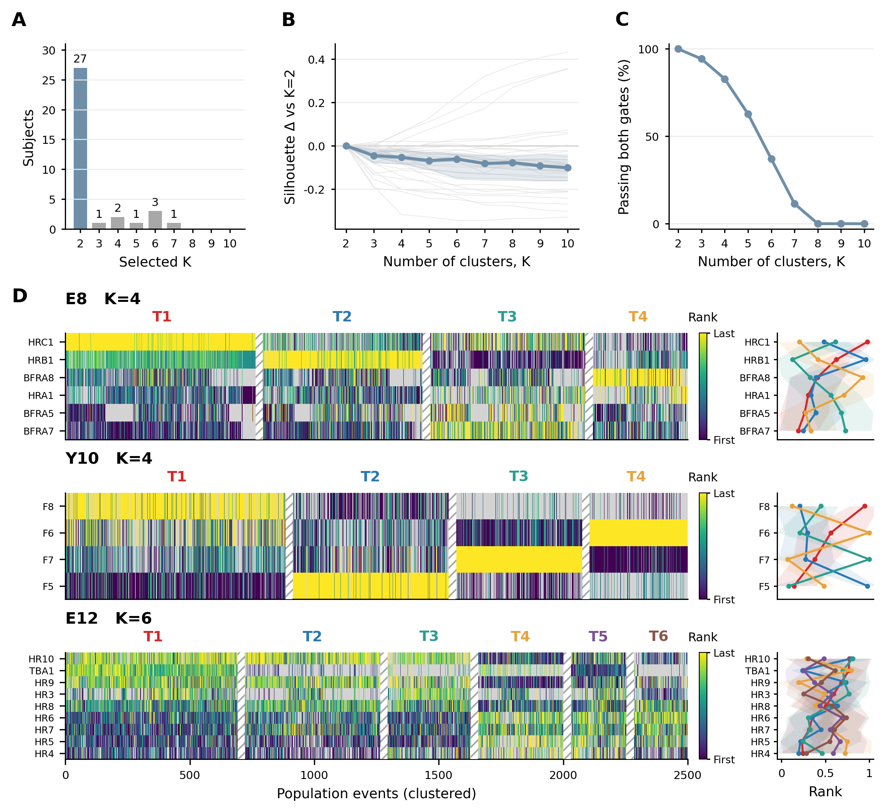

# Supplementary Figure 3：时序与时空聚类

更新：2026-11-02。

## 结果与选图

在同35名患者、同一批间期 HFO 群体事件中，仅时序聚类有 29/35 名患者选择 K=2，加入三维传播方向后为 27/35；9 名患者的最优 K 改变。空间版 D 按加入空间信息后的最优 K 选例，展示 E8、Y10（K=4）和 E12（K=6）的高阶模板结构。

| 分析 | 患者 | 事件范围 | 所选 K 的人数分布 |
|---|---:|---|---|
| 原时序 S3 | 40 | 至少3个参与触点 | K=2：34，K=3：1，K=4：2，K=5：2，K=6：1 |
| 原时序 S3 中有空间信息者 | 35 | 至少3个参与触点 | K=2：29，K=3：1，K=4：2，K=5：2，K=6：1 |
| 本次匹配的时序对照 | 35 | 全部可用事件 | K=2：29，K=4：3，K=5：1，K=6：2 |
| 本次时空聚类 | 35 | 与上一行相同 | K=2：27，K=3：1，K=4：2，K=5：1，K=6：3，K=7：1 |

建议保留原时序 S3，支撑主图1的时序模板结构；另加空间聚类补图，对应主图2的方法。空间补图优先采用上排同时展示时序与时空聚类、下排展示时空热图的版本。这能直接呈现空间信息带来的分组变化，也保留原文34/40的依据。

## 图与图注

**时空聚类的模板数量与间期 HFO 传播顺序。**

**A，** 35 名患者采用时序 rank 与三维传播方向联合聚类，在 $K=2$–$10$ 中选出的模板数分布。

**B，** 各患者相对于 $K=2$ 的轮廓系数变化。灰线为患者，蓝线及阴影为队列中位数及四分位距。

**C，** 各 K 下满足种子间中位调整互信息（AMI）≥0.70、最小簇事件占比≥0.10 的患者比例；在满足条件的解中按中位轮廓系数选择 K。

**D，** 自上而下为 E8（$K=4$）、Y10（$K=4$）、E12（$K=6$）。每位患者展示 2,500 次按时空聚类标签排列的间期 HFO 群体事件。颜色表示事件内归一化招募秩次，灰色为未参与触点；右侧为各模板的触点平均归一化秩次及 ±1 个标准差。

[空间版 PDF](../figures/current/S3_spatial.pdf)

**加入空间方向前后的模板数量与间期 HFO 传播顺序。**

**A，** 同 35 名患者、同一批间期 HFO 群体事件在仅时序聚类（灰）与时空聚类（蓝）中选出的模板数分布。

**B，** 两种方法相对于各自 $K=2$ 的轮廓系数变化，中位数及四分位距。

**C，** 满足种子间中位 AMI≥0.70、最小簇事件占比≥0.10 的患者比例。在满足条件的解中，按中位轮廓系数选择 K。

**D，** 自上而下为 E8（$K=4$）、Y10（$K=4$）、E12（$K=6$）。每位患者展示 2,500 次按时空聚类标签排列的间期 HFO 群体事件。颜色表示事件内归一化招募秩次，灰色为未参与触点；右侧为各模板的触点平均归一化秩次及 ±1 个标准差。

[对照版 PDF](../figures/current/S3_spatial_comparison.pdf) · [同事件时序版](../figures/current/S3_matched_timing.png) · [时序版 PDF](../figures/current/S3_matched_timing.pdf)

## 分析方法

从原40名患者出发检查空间信息可用性，不按原最优 K 筛选。35名患者可估计三维事件方向；Y12、Y13、Y18、Y19、Y20 缺少坐标文件。35名患者共 1,741,668 次事件，其中 194,766 次没有可估计方向，仍保留时序特征参与聚类。

沿用主图2的全事件时空聚类方法：先将参与触点的招募秩次归一化至0–1，未参与触点的聚类特征填为0.5；再用事件内秩次与真实 XYZ 坐标拟合三维传播方向。时序与空间两个特征组按总方差匹配尺度；方向缺失事件不参与空间中心和空间距离计算。XYZ 通过事件方向进入聚类，单次事件的原始招募顺序保持不变，更新的是事件标签及模板均值。

将主图2固定 K=2 的拟合扩展至 K=2–10。各 K 使用10个随机种子，每个种子10次初始化。选择条件沿用原 S3：种子间两两 AMI 的中位数≥0.70，各种子最小簇占比均≥0.10；在满足条件的 K 中选择中位轮廓系数最高者。每个种子的轮廓系数最多抽取2,000次事件，跨 K 共用抽样。事件对距离包含时序平方距离；当两次事件均有方向时，再加入缩放后的三维方向平方距离，最后开方。

仅时序对照与空间分析使用相同35名患者、相同事件范围、K范围及选择阈值。原S3与主图2的事件纳入范围存在差异，因此原S3统计保留，并另算本次全事件时序对照。图中以患者为队列统计单位；这是全数据上的模板数量分析，主图2的留出方向检验继续采用原有固定 K=2 结果。

三位示例为 E8、Y10、E12，时空聚类后的最优 K 分别为4、4、6。E8、Y10为本队列全部K=4患者；K=6患者包括E9、E12、Y17，其中选用当前主图2已有的空间示例E12。每位患者两种方法共用触点顺序与2,500次显示事件，按各自聚类标签排列；按簇大小排列模板。热图和右侧均值曲线均显示参与触点的归一化秩次，灰色为未参与触点。色条位于热图与右侧曲线之间，与热图等高，顶部横排 Rank；右侧触点名与热图逐行对应。

## 最优 K 改变的患者

| 患者 | 仅时序 K | 时空 K |
|---|---:|---:|
| E8 | 2 | 4 |
| E9 | 2 | 6 |
| E12 | 2 | 6 |
| E19 | 4 | 2 |
| E11 | 4 | 2 |
| Y16 | 2 | 3 |
| Y17 | 4 | 6 |
| Y10 | 6 | 4 |
| Y11 | 6 | 7 |

[全部患者结果 CSV](S3_spatial_clustering.csv)
