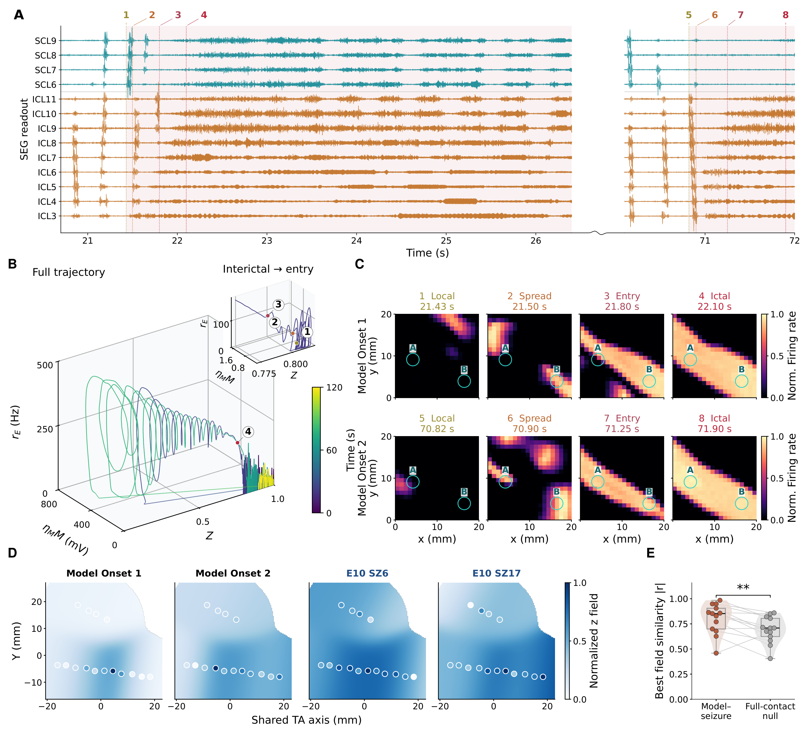
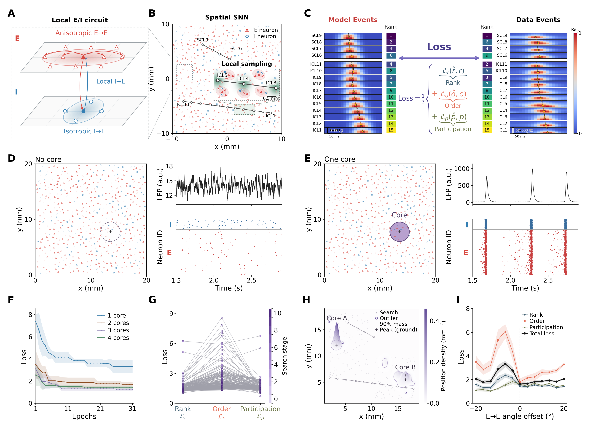
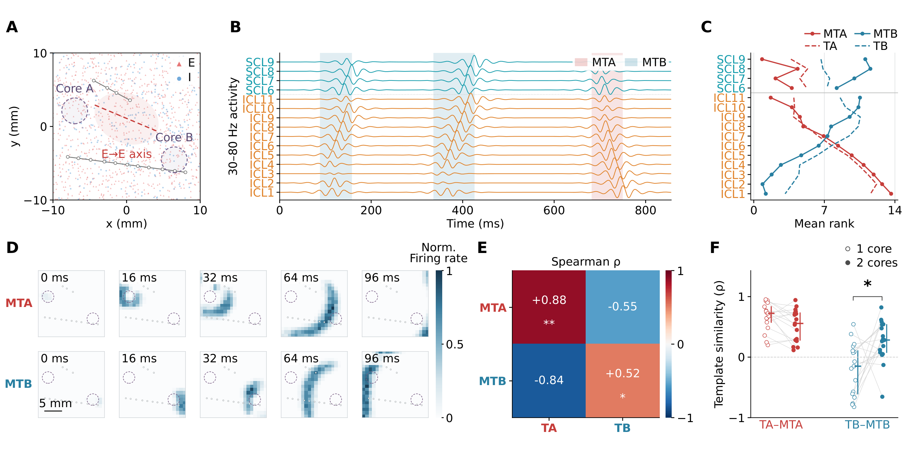
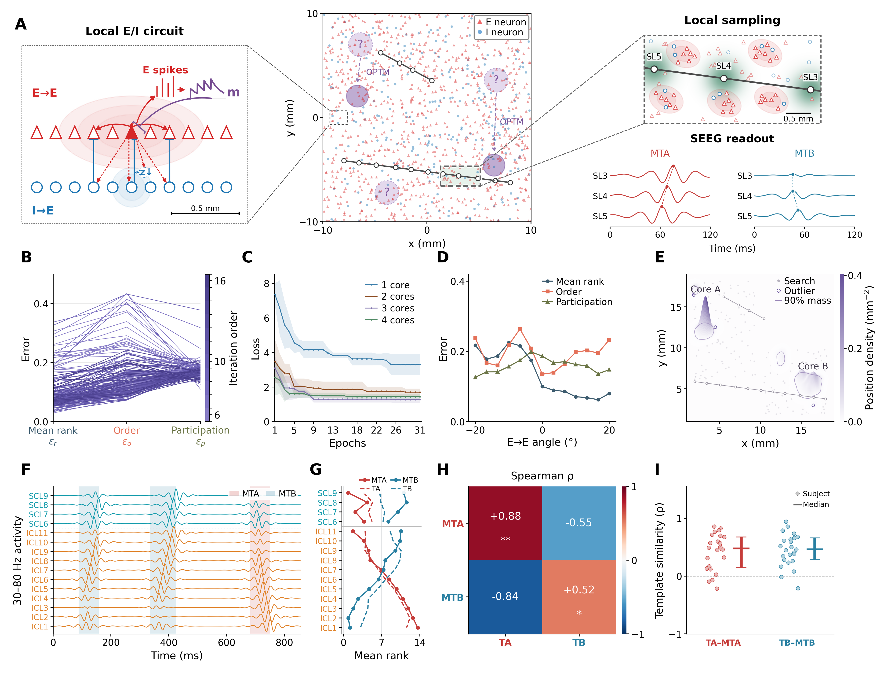
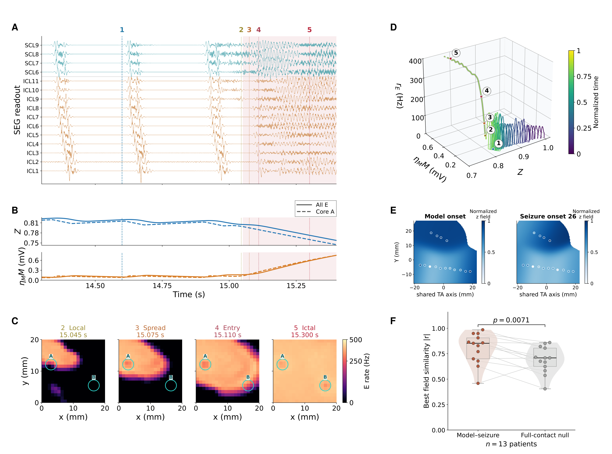

# 癫痫模型更新与Figure4到6重排

**2026 年 10 月 26 日—11 月 1 日**

本周先整合全局抑制与适应机制，用更新后的模型完成 Figure 6 的连续仿真展示；再梳理 Figure 4–6 的重排，将网络构建与优化、传播重现、状态转变分别展开。

## 一、模型更新与 Figure 6 展示

### 方法更新｜全局抑制与统一幅度适应

本次更新要解释：网络进入持续高活动后，什么反馈使它退出，以及退出后如何恢复。设计参考 **Liou 等（2020，LF Abbott 为共同作者）** 的局灶性发作模型：活动依赖的慢钾电流适应与广泛反馈抑制分别对应原文公式 4、5。我们将这两类反馈引入已有空间 SNN，再简化细胞内的适应部分。[Liou et al., 2020, *eLife*](https://elifesciences.org/articles/50927)

**1．从原模型到整合模型：改了哪几项**

公式中，蓝色 $\color{#0072B2}{G}$ 表示相对原模型增加的**全局抑制**，橙色 $\color{#C35A00}{\eta_M M_i}$ 表示**整合后的适应电流**；黑色项保留原有作用。兴奋性神经元的膜电位方程为：

$$
\begin{aligned}
\text{原模型：}\quad &\tau_m\dot V_i=-V_i+I_{E,i}-Z_iI_{I,i}-\eta_M M_i^{\mathrm{old}},\\
\text{整合后：}\quad &\tau_m\dot V_i=-V_i+I_{E,i}-Z_iI_{I,i}
-{\color{#0072B2}{Z_iG(V_i-E_G)}}-{\color{#C35A00}{\eta_M M_i}}.
\end{aligned}
$$

左侧表示膜电位变化；右侧依次是漏电、兴奋性及背景输入 $I_E$、局部抑制 $ZI_I$、全局抑制和细胞适应。$Z_i\in[0,1]$ 表示可用抑制资源，决定抑制还能发挥多大作用；电流按漏电导归一化，因此这里的电流项以 mV 表示。$E_G$ 是全局抑制的反转电位，$G(V_i-E_G)$ 将抑制电导换算为电流。

原模型只有 $Z$ 与基础适应 $M^{\mathrm{old}}$。此前的扩展版本在此基础上加入 $G$，并单独保存拟钾电导 $K_i$，因此同时存在 $M$、$K$ 两套细胞适应记忆。本次保留独立的 $G$，将后两者的适应作用合并到单一状态 $M_i$，适应电流仍写为 $\eta_M M_i$。其中，$M_i$ 记录适应状态，$\eta_M$ 将其换算为电流幅度，$\eta_M M_i$ 表示实际作用于膜电位的适应强度：

$$
\underbrace{\eta_M M_i^{\mathrm{old}}+K_i(V_i-E_K)}_{\text{此前：两套细胞适应}}
\quad\xrightarrow{\text{参考电位近似与合并}}\quad
{\color{#C35A00}{\underbrace{\eta_M M_i}_{\text{现在：一套细胞适应}}}}.
$$

这里整合的是 **$M$ 与 $K$ 对细胞兴奋性的抑制作用**；$G$ 仍是一条独立的网络反馈通路。

**2．蓝色项：全局抑制感知什么，生理依据是什么**

“全局”指**汇总整个模型网络的 E 神经元活动，再形成各处共享的反馈抑制驱动**。它近似表示远距离兴奋性投射招募各地抑制性中间神经元的网络效应；各细胞实际受到的抑制还取决于自身的 $Z_i$ 和膜电位。Liou 等（2018）在急性啮齿动物局灶性发作实验中观察到，局部发作伴随病灶外广泛的 PV 阳性中间神经元活动；阻断远处抑制可使远端区域被招募。这为广泛抑制限制发作扩展提供了实验依据。[Liou et al., 2018, *Brain*](https://pubmed.ncbi.nlm.nih.gov/29757347/)

我们用一个群体变量实现该反馈：

$$
{\color{#0072B2}{\tau_G\dot G=G_{\max}q(R)-G}},\qquad
q(R)=\mathrm{clip}\!\left(\frac{R-200}{300},0,1\right).
$$

$R$ 是经 15 ms 因果滤波的全体 E 神经元平均发放率（Hz），同时受活跃细胞数量与其放电强度影响。$q$ 在 $R\leq200$ Hz 时为 0，在 200–500 Hz 间线性增加，随后饱和；$G$ 以 0.5 s 的时间常数追随这一驱动，最大值为 30。因此，高活动会招募更强的反馈，活动降低后反馈逐渐消退。这些门限与时间常数是当前 SNN 的实现参数，并非直接照搬 Liou 原文。

**3．橙色项：慢钾电流如何整合为幅度适应**

慢后超极化（sAHP）钾电流提供了细胞适应的生理原型：反复放电增强外向电流，降低后续兴奋性。Liou 2020 用随发放率累积、随后衰减的慢钾电导表示这一作用。[Liou et al., 2020，公式 4](https://elifesciences.org/articles/50927#equ4) 我们保留这种活动历史依赖，将 $K_i(V_i-E_K)$ 的电流效应在 $V_{\mathrm{ref}}=18$ mV 处换算，与原有基础适应一起整合进 $M_i$；$\eta_M M_i$ 是抑制膜电位的电流幅度，未显式模拟离子浓度。

$$
{\color{#C35A00}{\dot M_i=-\frac{M_i}{\tau_M(R)}
+\Delta M(R)\sum_k\delta(t-t_i^k)}},\qquad
\Delta M(R)=\frac{1}{\eta_M}\left[\frac{a_0}{\tau_M(R)}+a_1q(R)\right].
$$

这条公式表示：**每次本细胞放电，$M_i$ 增加 $\Delta M(R)$；两次放电之间，$M_i$ 指数衰减。** 对应的适应电流 $\eta_M M_i$ 每次增加 $\eta_M\Delta M(R)$，因此状态增量中保留 $1/\eta_M$ 的换算。 $t_i^k$ 是第 $k$ 次放电时刻；全局活动只调节增量与衰减速度，各细胞仍保留自己的放电历史。$a_0=0.0005$ mV·s 保留原基础适应在固定时间常数下的单次放电电流积分；$a_1=7.68$ mV 来自原拟钾电导增量的参考电位换算，即 $0.16[18-(-30)]$。

原基础适应的增量固定、衰减时间为 1 s；现在高活动通过 $q(R)$ 增强每次放电的适应增量，$R>5$ Hz 时 $\tau_M=0.5$ s，$R\leq5$ Hz 时延长为 5 s。后者让活动下降后仍保留一段适应作用。$\eta_M M_i$ 直接作用于膜电位，不乘以抑制资源 $Z_i$，因此即使突触抑制减弱，细胞自身的适应仍可发挥作用。

**4．为什么这样更简洁，以及怎样连接发作终止**

合并后，每个 E 神经元的适应状态由 $M$、$K$ 两个减为一个，少一条状态方程，也减少了分别设定两套适应记忆的需要。两类反馈的分工更清楚：**$G$ 响应网络整体活动，$M_i$ 保存本细胞的放电历史。** 这种简化更适合用少量状态变量解释 Figure 6 的连续轨迹；代价是省略独立的 $M$、$K$ 时间过程及钾电导随膜电位变化的作用，属于参考电位下的现象学近似，尚不能据此声称患者拟合更优。

在 Liou 2020 的模型中，广泛抑制随招募范围扩大而增强，使发作前沿减速；慢钾适应压低持续放电，两者促使前沿消失。随后静默间隔延长，为抑制恢复创造时间，剩余簇发逐渐减弱并终止。这是我们借鉴的终止机制。[Liou et al., 2020，发作前沿消失与终止前阶段](https://elifesciences.org/articles/50927)

在我们的模型中，这一思路落实为 **群体高活动招募 $G$、细胞放电累积 $M_i$、活动下降后适应尾迹维持低活动窗口、抑制资源 $Z$ 得以恢复**。$Z$ 按抑制负荷以 5 s 时间常数耗竭或恢复；负荷由原局部 $I_I$ 扩展为 $I_I+G(V_{\mathrm{ref}}-E_G)$，适应电流不计入该负荷。由此，终止后的恢复还依赖抑制负荷下降。新版 Figure 6 用不重置状态的 120 s 连续仿真展示两次进入及其间的终止、恢复轨迹；该轨迹展示整合后的动力学，各反馈对终止的独立贡献仍需相应消融区分。

### Figure 6｜连续发作、间期轨迹与患者发作能量场

**同一连续网络中的两次发作进入呈现不同的空间招募过程，并可与患者发作能量场比较。**

**A，** 同一 120 s 连续仿真中的两段虚拟触点活动，显示窗口为 8.10–13.80 s 和 58.50–60.40 s，采用 80–1000 Hz 带通和相同固定显示增益。编号 1–4、5–8 分别标记两次进入过程的局部活动、传播扩展、进入和发作状态；阴影标示所示发作段。两段间省略时间内包含第一次终止与后续间期，首次终止时刻为 17.20 s，图中 Termination 文字为阶段示意。

**B，** 由平均抑制资源 $Z$、有效适应强度 $\eta_M M$ 与兴奋性细胞发放率 $r_E$ 构成的 0–118 s 状态轨迹。颜色表示时间，右上插图放大间期及第一次进入前的轨迹，编号与 A 对应。

**C，** 两次进入过程的二维空间活动，分别对应 A 的 1–4、5–8。每帧显示 20 ms 窗口的 E 神经元发放率，圆圈标记 Core A/B。每行以完整进入窗口中所有网格、所有时刻的最高发放率为共同分母，归一化至 0–1，保留行内各阶段的相对强弱；两行颜色用于比较传播形态。

**D，** 两个模型进入窗口与患者 E10/SZ13、SZ14 的 1–150 Hz 发作能量场。模型窗口分别为 8.85–9.85 s、59.30–60.30 s，患者窗口为临床起始后 0–10 s；各场由基线标准化能量变化构建，并独立归一化至 0–1 显示。对每个固定模型窗口，从 E10 的 25 次合格发作中选择有符号场相关最高者，相关系数分别为 0.850、0.920。该示例展示最佳匹配的空间形状。

**E，** 沿用先前模型的患者队列比较：13 名患者、140 次合格发作的最佳绝对场相关系数与全触点置换对照。每点代表一名患者，箱体表示中位数和四分位距，细线连接患者与其对照。统计基于 dB 功率变化，并在每次置换中重复相同的最佳发作选择过程（99,999 次）；\*\*，$P=0.00708<0.01$。此项保留原队列结果，尚未换成 A–D 新连续轨迹的队列重算。

原 Figure 5 改为 Figure 6 后，重点从一次进入高活动状态，扩展到同一连续仿真中的发作、终止后间期和再次进入。波形、状态轨迹及空间帧相互对应，最后以模型与患者能量场的比较连接临床观察。

[PNG](figures/current/Figure6.png) · [PDF](figures/current/Figure6.pdf)

---

## 二、Figure 4–6 重排

### 图件重排与主要修改

| 图 | 主要修改 | 修改逻辑 |
|---|---|---|
| Figure 4：结构与优化 | 重画 A/B；新增 C，将模型与患者事件、Rank／Order／Participation 和总损失串联；原 core 数量、损失、位置密度和方向响应排为 F–I。 | 先说明网络与电极读出，再说明患者数据如何进入优化，最后展示优化结果。 |
| Figure 4：活动对照 | 新增 D/E 的无 core 背景与单 core 簇发；并排显示网络地图、LFP 代理和 raster。统一 B/D/E 的神经元示意布局，避免符号重叠；仅 E 的 core 内保留紫色。 | 让读者直观看到低活动背景与局部同步簇发的区别，并能将空间结构对应到信号与放电。 |
| Figure 4 → Figure 4、5 | 将原图中的传播读出、秩次对应和模板匹配独立为 Figure 5。 | 分别回答“怎样构建和优化模型”与“优化后能否重现患者传播模式”，减轻单图的信息负担。 |
| Figure 5 | 增加清楚的双 core 空间示意、共同时间点的二维传播序列，以及 17 位患者的单／双 core 比较。 | 从单个工作点的传播过程，推进到患者层面的第二模板拟合比较。 |
| 原 Figure 5 → Figure 6 | 原状态转变图重新编号为 Figure 6；更新为同一连续仿真中的两次进入、间期轨迹、空间传播和患者场示例，保留原队列统计。图与详细图注见上节。 | 紧接模型更新展示其动力学结果，并与 Figure 4、5 的网络优化和传播重现分开。 |

### Figure 4｜患者间期时空模式约束的空间 E–I 网络构建与优化

**从局部回路、电极读出和优化目标，说明患者间期活动如何约束空间网络。**

**A，** 局部二维兴奋–抑制网络结构。$E\to E$ 连接采用椭圆形各向异性连接核，其余局部通路采用圆形各向同性连接核；上下两层用于区分 E、I 群体，表示 B 中的局部网络。

**B，** 患者电极布局下的完整空间网络。依据患者 SEEG 触点几何设置二维网络中的虚拟电极，插图显示触点邻域的局部连接与高斯采样权重。

**C，** 患者间期事件约束的参数优化。模型与患者事件的秩次模式、传播顺序和触点参与分布分别构成损失 $\mathcal{L}_r$、$\mathcal{L}_o$ 和 $\mathcal{L}_p$，总损失为 $J=(\mathcal{L}_r+\mathcal{L}_o+\mathcal{L}_p)/3$。两侧以代表事件展示时频图和训练秩次：圆点表示谱图质心，短竖线表示训练秩次对应的时刻。实际训练比较整段 60 s 仿真中合格事件的分布，代表事件用于说明各特征的含义。

**D，** 无 core 网络的背景活动。均匀背景输入下，网络呈稀疏放电和低幅 LFP 代理信号；虚线圆标示与 E 相同的局部读出区域，右下显示该区域内 E、I 神经元的放电。

**E，** 单 core 网络的局部簇发活动。紫色填色圆区标示 core 的位置与范围，圆外保持白底。右侧显示局部 847 个 E 神经元、191 个 I 神经元的放电及对应 LFP 代理信号，短暂同步簇发伴随明显的瞬态峰值。D、E 的 LFP 纵轴分别缩放，a.u. 表示任意单位。

**F，** core 数量对拟合表现的影响。双 core 获得相对单 core 的主要损失下降，增加至三、四 core 的额外改善较小。曲线与阴影表示 E10 对应网络每组 4 次优化重复、共同前 31 个 epoch 内最佳训练损失的均值 ± 样本标准差。

**G，** 参数搜索中的损失变化。随搜索推进，三类损失总体向较低水平集中，但不同分量的改善程度并不一致。

**H，** 低损失配置的 core 位置分布。413 个可评分配置中训练损失最低的 20%（83 个）形成两个主要位置集中区；灰点表示搜索位置，轮廓包围各 core 位置密度的 90% 质量，十字标示密度峰的平面位置。

**I，** $E\to E$ 连接方向对拟合损失的影响。彩色曲线表示三个损失分量，黑线表示总损失，阴影表示时间块重采样标准差。在测试的 13 个方向中，总损失在相对参考轴偏移 $0^\circ$ 时最低，竖虚线标示该位置。

新增 C 把“模型输出、患者事件、损失计算”放到同一条阅读路径上，使优化方法更直观。新增 D/E 让读者先看到无 core 时的低活动背景，以及引入 core 后的局部簇发，再阅读 core 数量、损失、位置和方向的优化结果。原来集中在一张图中的传播重现结果独立为 Figure 5，使 Figure 4 能完整回答“模型怎样建立、数据怎样约束它”。

[PNG](figures/current/Figure4.png) · [PDF](figures/current/Figure4.pdf)

### Figure 5｜双 core 空间网络重现患者双向间期传播

**同一双 core 网络产生方向相反的传播事件，并与患者 TA、TB 模板对应。**

**A，** 优化后代表性网络的空间结构。紫色虚线圈标示 Core A、Core B，红色椭圆及虚线标示 $E\to E$ 连接的各向异性主轴，灰色线与圆点表示虚拟电极杆及触点。

**B，** 同一网络中的双向传播读出。连续 30–80 Hz 虚拟触点活动中出现 MTA、MTB 事件（阴影），两类事件表现出相反的触点招募顺序。

**C，** 模型与患者的平均传播秩次。两类模型事件的平均秩次（实线）分别与患者 TA、TB 模板（虚线）总体一致。

**D，** 两类事件的二维传播过程。MTA、MTB 分别从 Core A、Core B 附近起始并向相反方向扩展，各列显示距事件起始 0、16、32、64、96 ms 的活动。颜色为按各完整事件的时空峰值归一化的放电率；同一事件各帧共用分母，标尺为 5 mm。

**E，** 模型传播模式与患者模板的交叉匹配。通过交替触点分折分配事件并评估 Spearman 相关，MTA–TA 和 MTB–TB 呈正相关，交叉组合呈负相关。A–E 使用同一双 core 工作点。

**F，** 17 位患者当前搜索结果中的单、双 core 比较。单 core 在 $\rho_{TA}>\rho_{TB}$ 的配置中选择最低训练损失，双 core 采用原最低损失配置；分别使用前 16、32 次搜索。双 core 对 TB 的匹配优于偏 TA 的单 core 配置。空心、实心点分别表示单、双 core，细线连接同一患者，横线及竖段表示中位数和四分位范围。此比较保留两种选点策略的差异。

E 采用单侧杆内触点置换检验（1,000 次，未校正）；F 采用配对双侧 Wilcoxon 符号秩检验，并对 TA、TB 两项比较作 Holm 校正。\*，$P<0.05$；\*\*，$P<0.01$。

拆分后，Figure 5 按“空间结构—连续读出—秩次对应—二维传播—模板匹配—患者比较”展开。新增的传播帧直接展示两类事件从何处起始、向何处扩展；单／双 core 比较进一步说明双 core 配置对第二类传播模式的拟合表现。

[PNG](figures/current/Figure5.png) · [PDF](figures/current/Figure5.pdf)

## 补充材料：修改前的 Figure 4、5

以下保留 10 月 23 日周报中的 Figure 4、5，便于对照本次拆分和扩展。

### 原 Figure 4｜患者间期时空重演约束的空间 E–I 网络

**患者数据驱动的二维 E–I 脉冲网络重建间期传播模式。**

**A，** 局部兴奋–抑制回路、易激区配置与虚拟触点读出示意。适应变量 $m$ 和抑制效能变量 $z$ 调节网络活动，局部采样将活动映射为触点招募顺序。

**B，** 参数搜索中的平均秩次误差 $\varepsilon_r$、杆内顺序误差 $\varepsilon_o$ 和触点参与误差 $\varepsilon_p$；每线为一个参数配置，颜色表示迭代顺序。

**C，** E10 对应网络中一至四个易激区的拟合比较。各组 4 次优化重复，曲线与阴影为前 31 个 epoch 最佳训练损失的均值 ± 标准差。

**D，** E→E 连接方向偏移对三类传播误差的影响。

**E，** 联合误差最低 20% 配置中的 Core A/B 位置密度；灰点为搜索位置，轮廓包围 90% 密度质量，空心点为轮廓外的入选位置。

**F，** 同一网络连续的 30–80 Hz 虚拟触点活动，阴影标记交替出现的 MTA、MTB 事件。

**G，** 模型 MTA/MTB（实线）与患者 TA/TB（虚线）的平均招募秩次。

**H，** 模型簇与患者模板的 Spearman 相关矩阵。对应组合为正相关，交叉组合为负相关；杆内触点置换检验，\*，$P<0.05$；\*\*，$P<0.01$。

**I，** 25 名患者的 TA–MTA 和 TB–MTB 模板相似度。点代表患者，横线与误差线分别为中位数和四分位距。

[PNG](figures/previous/Figure4.png) · [PDF](figures/previous/Figure4.pdf)

### 原 Figure 5｜反复间期传播与网络状态转变

**模型慢变量变化伴随持续高活动状态的进入。**

**A，** 15 个虚拟触点在 14.3–15.4 s 的 80–1000 Hz 电流读出，展示短暂事件向持续高活动的转变；编号 1–5 标记代表性状态。

**B，** 抑制资源 $Z$ 与有效适应强度 $\eta_M M$ 的时间变化。实线为全部兴奋性细胞的均值，虚线为 Core A 均值，与 A 共用时间轴。

**C，** 状态 2–5 的空间发放率，分别对应 15.045、15.075、15.110 和 15.300 s。各帧取 20 ms 窗口并共用 0–500 Hz 色标；圆圈标记 Core A/B。

**D，** 由 $Z$、$\eta_M M$ 和兴奋性细胞发放率 $r_E$ 构成的状态轨迹，颜色表示归一化时间，编号与 A 对应。

**E，** 模型进入后 1 s 与选取的 E10/SZ26 起始后 0–10 s 的宽频能量场（1–150 Hz，$r=0.846$）。两场分别归一化至 0–1，仅比较空间形状。

**F，** 13 名患者、140 次发作的模型–发作场最佳绝对相关系数与全触点置换对照。统计基于 dB 功率变化，置换中重复相同选择过程（99,999 次，$P=0.0071$）。每点为一名患者，箱体表示中位数和四分位距。

[PNG](figures/previous/Figure5.png) · [PDF](figures/previous/Figure5.pdf)
